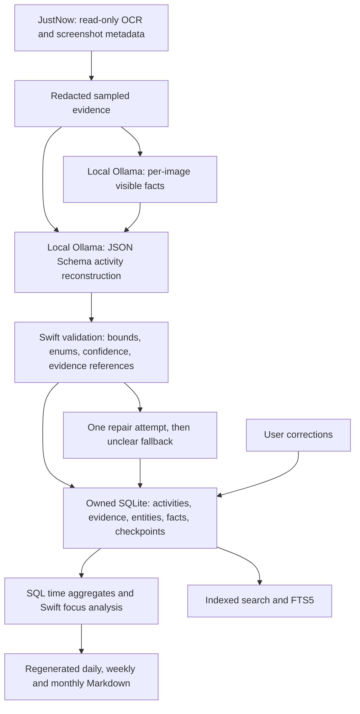

# Activity history foundation

The previous engine wrote `lastProcessedAt` but always chose `end − lookback`. Each request appended Markdown; overlapping windows inflated potential totals, and daily prose depended on prior prose. Application identity alone could not establish intent, outcomes or actual duration.

## Layer distinctions

| Layer | Meaning | Authority |
| --- | --- | --- |
| Observation | Raw JustNow frame/span, display, timestamp and OCR text | External, read-only; finite retention |
| Evidence | Selected redacted OCR excerpt or inferred visible screenshot description, with source ID/path and time | Owned bounded supporting material; OCR OBSERVED, vision INFERRED |
| Activity | Validated primary time block, controlled purpose category/intent, project, entities and background context | Canonical record; generally INFERRED, corrected records USER_CONFIRMED |
| Outcome | A distinct model-extracted fact linked to an activity and specific evidence IDs | INFERRED, with its own confidence; requested or proposed work is not proof of completion |
| Report | Reproducible projection of original facts and deterministic measurements | Disposable Markdown, never a source for subsequent summaries |

Activity confidence, classification confidence, project confidence and per-fact confidence are separate. A configured, unique project alias match has conservative project confidence 0.75; missing/ambiguous/low-confidence evidence has no project. Numeric confidence is model/inference metadata, not a calibrated probability. A correction confirms the record's classification/title provenance; evidence and extracted facts keep their original provenance. The model cannot declare facts observed or user-confirmed.

## SQLite schema (current user_version = 3)

| Table | Columns / purpose |
| --- | --- |
| `metadata` | key, value; durable lastProcessedTimestamp |
| `processing_windows` | deterministic SHA-256 id, start, end, created_at; source interval completion |
| `activities` | deterministic id, window_id, start, end, title, summary, category, intent, project_id, confidence, classification_confidence, project_confidence, source, provenance, payload, created_at, updated_at |
| `evidence` | id, window_id, timestamp, display, excerpt, screenshot_reference, type, confidence, source_reference, provenance |
| `activity_evidence` | activity_id, evidence_id; many displays/evidence items can support one activity |
| `projects` | id, canonical name, aliases JSON, optional configured repository, first_seen, last_seen, status |
| `entities` | id, controlled kind, name |
| `activity_entities` | activity_id, entity_id |
| `facts` | id, activity_id, outcome/problem/decision kind, text, timestamp, project_id, confidence, provenance, problem status, evidence_ids JSON |
| `corrections` | id, activity_id, timestamp, correction payload; audit trail |
| `activity_fts` | FTS5 activity_id/body for titles, summaries, background, entities and facts |

Duration is derived from end − start, rather than stored redundantly. Codable payloads preserve the complete record while indexed relational columns support SQL filtering/aggregation. No daily/weekly/monthly aggregate cache is needed initially. Milestones, goals and embeddings have not been added speculatively.

Indexes cover interval, project/time, category/time, intent/time, entity name and fact kind/project/time. Foreign keys and range/confidence checks protect relationships. `BEGIN IMMEDIATE`, FULLMUTEX connections, WAL, busy timeout, and triggers reject overlapping windows and activities even across independent CLI/menu-bar processes. Swift enums and validation constrain taxonomy; SQL inserts are internal and bound. No arbitrary model-generated SQL executes.

## Migrations

1. Create canonical tables, indexes, foreign keys and overlap triggers.
2. Add audited corrections and FTS5; backfill existing activity payloads into search.
3. Add explicit evidence source references/provenance and mark previous vision descriptions INFERRED.

Upgrades back up the database through SQLite's backup API, then migrate under one transaction. Startup rereads schema version after acquiring the transaction lock to handle another process migrating concurrently. Newer versions are refused. User history is not silently converted from Markdown, and legacy JSON checkpoints are not trusted. File backups precede replacing legacy Markdown; report writes are atomic.

## Non-overlap and replay

Automatic processing starts at the **owned database** checkpoint and ends at now minus grace. Initial history starts only at a configured lookback; missed intervals are bounded and split at midnight. Future explicit windows are excluded from catch-up; filling their preceding gaps reconnects the checkpoint across contiguous stored windows. Empty evidence periods have completed windows but no tracked activities.

Exact interval IDs cache canonical results. An ordinary exact replay regenerates reports without another model call. Different overlapping canonical intervals are rejected. Explicit `--reprocess` atomically replaces the same unconfirmed interval, including facts, evidence joins and search entries. A failed replacement transaction rolls back. Intervals containing user corrections cannot be reprocessed until a future correction-aware segmentation merge is implemented.

Model-provided offsets must be finite, ordered, positive-duration and within the owned interval. Gaps become unknown blocks. Entity/fact counts and text sizes are bounded; every model fact must cite known activity evidence. Validating references establishes provenance, not semantic truth—model hallucination is still possible. Unconfirmed statements remain INFERRED and can be reviewed or corrected.

## Time semantics

At most one primary activity exists at a moment, regardless of display count. Music beside Xcode may be background text without another duration. SQLite clips intervals at query boundaries and sums primary seconds. Active/classified excludes `unclear` category or `UNKNOWN` intent. Coverage is estimated allocation, not continuous attention, actual idle detection or computer-input measurement.

Focus joins only exactly adjacent coherent states; project, category and intent must match (unassigned records also require matching title). Default focus threshold: 25 minutes, configurable. Meaningful switching considers states lasting at least two minutes and gaps up to five minutes; it does not count screenshots. Creation = BUILD + FIX; consumption = CONSUME; research/learning/planning stay separate. No score is generated.

## Retention and growth

Keep activities/facts/entities/corrections indefinitely. Store bounded selected excerpts and screenshot **references**, with zero image duplication. OCR and vision sampling are bounded per window. Raw JustNow history retains JustNow's own policy; old screenshot references may break. Owned excerpts allow reviewing why inference occurred after external pixels expire, but do not reproduce the original full evidence. SQL aggregates can span years without loading records. Reports load one day/week/month; yearly trend/query interpretation and aggregate caches remain future work.

## Source changes

New: ActivityModels, ActivityStore, ActivityJSONSchema, ActivityPrompts, ActivityReports, LegacyMarkdownImporter, ActivityFoundationTests, this architecture document and session verification.

Changed: Package.swift (SDK SQLite on macOS), Models (owned storage/focus/diagnostics configuration), OllamaClient (constrained reconstruction, validation/repair, local-only endpoints), WorklogEngine (transactional canonical path, inspection, checkpoint catch-up, injectable client), CLI (reports/stats/search/correct/import/reprocess), menu bar (canonical Summarize Now, today's statistics, weekly review), existing engine/Ollama tests (new semantics and integration stubs), README and `.gitignore` (private verification output).

Existing JustNow reader, OCR preprocessor/deduplicator, screenshot selection, StateStore and legacy WorklogWriter/Diary interfaces remain available. JustNow itself was not changed.

## Deferred roadmap

Git evidence collection; goals and goal progress; semantic problem matching/lifecycle linking; milestones; annual monthly trend retrieval; natural-language query planning/`ask`; JSON/CSV export commands; semantic embeddings; AI weekly improvement interpretation; selected screenshot-copy retention; richer search/settings/correction UI; advanced field-level correction merging. Basic outcomes/problems/decisions, monthly deterministic projections, legacy import and minimal menu-bar statistics are implemented, but do not constitute the whole roadmap.
